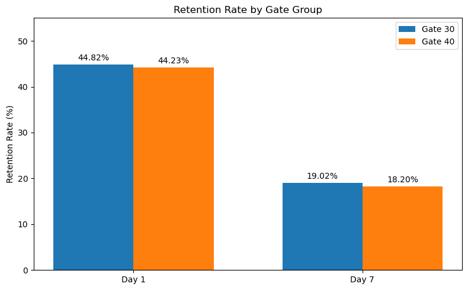
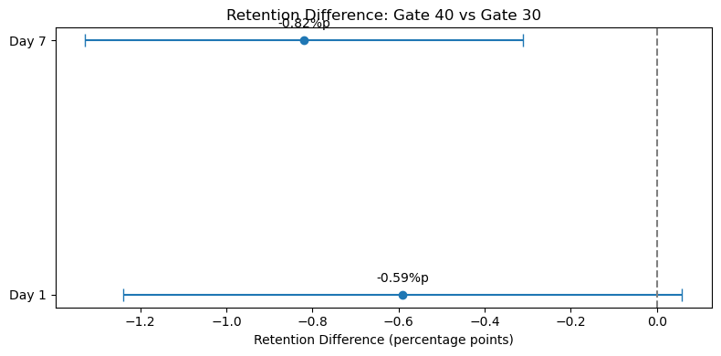

# Cookie Cats A/B 테스트 — 게이트 위치 변경에 따른 사용자 리텐션 분석

> 모바일 퍼즐 게임 Cookie Cats의 첫 번째 게이트를 레벨 30에서 40으로 옮기는 실험을 분석했습니다. **데이터 품질 확인 → 그룹 배정 비율 점검 → 리텐션 비교 → 통계 검정 → 실험 신뢰성 평가 → 의사결정 제안**의 흐름으로 진행했습니다. 공개 데이터만으로 확인할 수 없는 실험 설계 정보는 분석의 한계로 명시했습니다.

## 목차
- [프로젝트 배경](#프로젝트-배경)
- [데이터](#데이터)
- [분석 방법론](#분석-방법론)
- [분석 과정 및 결과](#분석-과정-및-결과)
- [결론 및 제언](#결론-및-제언)
- [기술 스택](#기술-스택)
- [한계 및 향후 개선 방향](#한계-및-향후-개선-방향)
- [프로젝트 구성 및 실행 방법](#프로젝트-구성-및-실행-방법)

---

## 프로젝트 배경

Cookie Cats는 플레이어가 게임을 진행하다 특정 레벨에서 게이트를 만나도록 설계된 모바일 퍼즐 게임입니다. 이 프로젝트에서는 **첫 번째 게이트를 레벨 30에서 레벨 40으로 이동했을 때 사용자 리텐션이 개선되는가?**라는 질문을 다뤘습니다.

게임 서비스의 제품 분석가가 다음과 같은 요청을 받았다고 가정했습니다.

> "첫 게이트를 레벨 30에서 40으로 늦추면 이용자가 더 오래 게임에 남을까요? 실험 결과를 확인하고 적용 여부를 제안해 주세요."

이를 다음과 같이 분석 가능한 질문으로 구체화했습니다.

| 항목 | 분석 기준 |
|---|---|
| 비교 대상 | Gate 30(기존 위치) vs Gate 40(변경 위치) |
| 핵심 지표 | 7일 리텐션(`retention_7`) |
| 보조 지표 | 1일 리텐션(`retention_1`) |
| 비교 방향 | **Gate 40 − Gate 30** (음수이면 Gate 40이 낮음) |
| 통계 기준 | 양측 검정, 유의수준 5%, 95% 신뢰구간 |
| 선행 점검 | 결측·중복 여부, 그룹 크기 및 50:50 가정하의 SRM |

## 데이터

- **출처:** [Kaggle — Mobile Games: A/B Testing (Cookie Cats)](https://www.kaggle.com/datasets/yufengsui/mobile-games-ab-testing)
- **파일:** `cookie_cats.csv`
- **규모:** 90,189행 × 5열 (사용자 90,189명)
- **분석 단위:** 사용자(`userid`) 1명당 1행
- **실험 그룹:** `gate_30`, `gate_40`

| 컬럼 | 의미 | 활용 |
|---|---|---|
| `userid` | 사용자 식별자 | 사용자 ID 중복 확인 |
| `version` | 배정된 게이트 그룹 | 실험군·대조군 구분 |
| `sum_gamerounds` | 게임 플레이 라운드 수 | 데이터 구조 확인(별도 효과 분석 제외) |
| `retention_1` | 1일 리텐션 여부(True/False) | 보조 지표 |
| `retention_7` | 7일 리텐션 여부(True/False) | 핵심 지표 |

> **리텐션 정의:** 이 프로젝트에서는 데이터셋이 제공하는 `retention_1`, `retention_7`의 참(True) 비율을 각각 1일·7일 리텐션으로 계산했습니다. 사용자의 실제 이벤트 로그를 이용해 별도로 리텐션을 재구성하지는 않았습니다.

## 분석 방법론

```text
CSV 데이터 로드
    ↓
데이터 품질 점검 (결측치 · 중복 행 · 사용자 ID 중복)
    ↓
그룹 배정 비율 확인 및 SRM 점검 (50:50 가정)
    ↓
Gate 30 / Gate 40의 1일·7일 리텐션 집계
    ↓
두 표본 비율 Z-test + 95% 신뢰구간(Newcombe)
    ↓
리텐션 비교 및 효과 크기 시각화
    ↓
실험 신뢰성 검토와 비즈니스 제안
```

- **Pandas:** 데이터 구조 확인, 품질 점검, 그룹별 리텐션 집계
- **SciPy:** 카이제곱 적합도 검정으로 그룹 크기의 기대 비율 부합 여부 점검
- **statsmodels:** 두 표본 비율 Z-test, 두 비율 차이의 Newcombe 95% 신뢰구간
- **Matplotlib:** 그룹별 리텐션 막대그래프, 차이 및 신뢰구간 시각화

## 분석 과정 및 결과

### 1. 데이터 품질 확인

원본 데이터의 결측치, 완전 중복 행, `userid` 중복을 확인했습니다.

| 점검 항목 | 결과 |
|---|---:|
| 전체 데이터 | 90,189행 |
| 결측치 | 0건 |
| 중복 행 | 0건 |
| 사용자 ID 중복 | 0건 |

→ 별도의 행 제거 없이 전체 90,189명을 분석에 사용했습니다. 다만 **결측·중복이 없다는 사실만으로 실험 로그 수집의 완전성이 입증되는 것은 아닙니다.**

### 2. 그룹 배정 비율 및 SRM 점검

| 그룹 | 사용자 수 | 전체 비율 |
|---|---:|---:|
| Gate 30 | 44,700명 | 49.56% |
| Gate 40 | 45,489명 | 50.44% |
| **합계** | **90,189명** | **100.00%** |

**SRM(Sample Ratio Mismatch)**은 실험의 관측 그룹 비율이 사전에 계획한 배정 비율과 일치하는지 점검하는 절차입니다.

- **가정:** 두 그룹의 목표 배정 비율이 50:50이었다고 가정
- **방법:** 카이제곱 적합도 검정
- **결과:** **p = 0.0086**
- **해석:** 50:50이 실제 목표였다면 관측된 그룹 크기는 기대 비율과 통계적으로 유의하게 다릅니다.

**중요한 한계:** 공개 데이터 설명에서 무작위 배정은 언급되지만, 정확한 **목표 배정 비율을 확인하지 못했습니다.** 따라서 이 SRM 검정은 **50:50을 전제로 한 조건부 점검**이며, 실제 배정 오류나 데이터 누락이 발생했다고 확정할 수 없습니다.

→ 후속 통계 분석을 수행하되, **실험 설계 정보가 확인되기 전까지 결과를 확정적인 인과 효과로 해석하지 않기로 했습니다.**

### 3. 그룹별 1일·7일 리텐션 비교

리텐션은 그룹별 `retention_1`, `retention_7`의 True 비율로 계산했습니다.

| 지표 | Gate 30 | Gate 40 | 차이 (Gate 40 − Gate 30) |
|---|---:|---:|---:|
| **1일 리텐션** | 44.82% | 44.23% | **−0.59%p** |
| **7일 리텐션** | 19.02% | 18.20% | **−0.82%p** |



→ 두 지표 모두 Gate 40에서 낮게 **관측**되었습니다. 다만 관측 차이가 우연한 표본 변동 범위를 벗어나는지는 별도의 통계 검정이 필요합니다.

### 4. 통계 검정: 두 표본 비율 Z-test

- **귀무가설(H₀):** 두 그룹의 리텐션 비율이 같다.
- **대립가설(H₁):** 두 그룹의 리텐션 비율이 다르다.
- **검정:** 양측 두 표본 비율 Z-test, 유의수준 0.05

| 지표 | Z-test p-value | 5% 유의수준에서의 판단 |
|---|---:|---|
| 1일 리텐션 | 0.0744 | 유의한 차이를 확인하지 못함 |
| 7일 리텐션 | 0.00155 | 유의한 차이가 관측됨 |

→ **1일 리텐션:** p-value가 0.05보다 크므로 차이가 없다고 확정하는 것이 아니라, **차이가 있다는 충분한 통계적 근거를 얻지 못했다**고 해석합니다.

→ **7일 리텐션:** p-value가 0.05보다 작아 통계적으로 유의한 차이가 관측되었습니다. 단, 이는 **실험 신뢰성 검토와 별개인 통계적 결과**입니다.

### 5. 효과 크기 및 95% 신뢰구간

두 비율 차이의 95% 신뢰구간은 **Newcombe 방식**으로 계산했습니다. 차이의 방향은 모두 **Gate 40 − Gate 30**입니다.

| 지표 | 관측 차이 | 95% 신뢰구간 | 해석 |
|---|---:|---|---|
| 1일 리텐션 | −0.59%p | [−1.2392, +0.0582]%p | 0 포함 |
| 7일 리텐션 | −0.82%p | [−1.3282, −0.3121]%p | 0 미포함 |



- 점은 관측된 리텐션 차이, 가로선은 95% 신뢰구간을 나타냅니다.
- 세로 기준선 **0%p**는 두 그룹의 차이가 없는 지점입니다.
- 1일 리텐션의 신뢰구간은 0을 포함하지만, 7일 리텐션의 신뢰구간은 0을 포함하지 않습니다.

→ **통계적 유의성과 실험의 인과적 신뢰성은 별개의 문제**입니다. SRM의 전제가 확인되지 않았으므로 7일 리텐션 감소를 게이트 변경의 확정적인 효과로 단정하지 않습니다.

## 결론 및 제언

**핵심 결론:** Gate 40 그룹의 7일 리텐션은 Gate 30보다 **0.82%p 낮게 관측**되었고 통계적으로 유의한 차이가 나타났습니다. 그러나 정확한 목표 배정 비율이 확인되지 않았고, 50:50 가정하의 SRM 검정에서도 유의한 불일치가 나타났습니다. 따라서 **Gate 40 변경이 리텐션을 감소시켰다고 확정하기보다는 실험 설정과 데이터 수집의 신뢰성을 먼저 검토해야 합니다.**

1. **Gate 40 확대 적용 보류:** 현재 데이터에서는 7일 리텐션 개선 근거가 없으므로, 변경을 확대하기 전에 실험의 유효성을 확인합니다.
2. **배정 설정 점검:** 실제 목표 배정 비율과 사용자 할당 로직을 확인하고, 해당 비율을 기준으로 SRM을 재평가합니다.
3. **데이터 수집 점검:** 실험 그룹별 이벤트 누락, 사용자 필터링, 수집 기간 및 집계 기준의 차이를 확인합니다.
4. **재분석 또는 재실험:** 실험 신뢰성이 확인되면 결과를 다시 해석하고, 문제가 발견되면 수정 후 재실험을 검토합니다.

## 기술 스택

`Python` `Pandas` `SciPy` `statsmodels` `Matplotlib` `Jupyter Notebook`

## 한계 및 향후 개선 방향

- **목표 배정 비율 미확인:** 50:50은 확인된 설계 정보가 아니라 SRM 점검을 위한 가정입니다.
- **실험 로그 및 설계 정보 부재:** 사용자 배정 로직, 로그 누락 여부, 수집 기간 등은 공개 데이터만으로 검증할 수 없습니다.
- **인과 해석 제한:** 관측된 유의한 차이를 곧바로 게이트 위치 변경의 인과적 효과로 확정할 수 없습니다.
- **분석 범위 제한:** `sum_gamerounds`의 이상치 및 플레이량별 효과, 세그먼트별 차이, 장기 리텐션은 이번 분석에서 다루지 않았습니다.
- **후속 분석:** 실험 설정 정보를 확보한 뒤 SRM 재검정, 게임 플레이량 분포 검토, 추가 지표 분석을 진행할 수 있습니다.

## 프로젝트 구성 및 실행 방법

```text
cookie_cats_portfolio/
├── README.md
├── cookie_cats_ab_test.ipynb
└── images/
    ├── retention_comparison.png
    └── retention_difference_ci.png
```

1. 위 Kaggle 출처에서 `cookie_cats.csv`를 받습니다.
2. CSV 파일을 `cookie_cats_ab_test.ipynb`와 같은 폴더에 둡니다.
3. Python 환경에서 `pandas`, `numpy`, `scipy`, `statsmodels`, `matplotlib`, `jupyter`를 설치합니다.
4. 노트북의 셀을 위에서부터 순서대로 실행합니다.

> 데이터 원본 CSV는 이 저장소에 포함하지 않았습니다. 분석 결과와 시각화는 공개 데이터의 관측값을 기준으로 작성했습니다.
